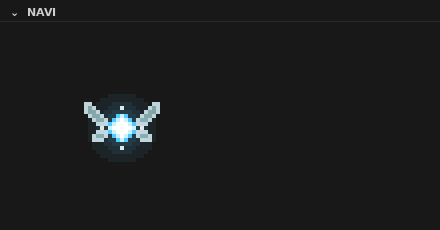

<p align="center">
  
</p>

<h1 align="center">Navi</h1>

<p align="center">
  A little pixel-art fairy that lives in the VS Code <b>Explorer</b>, right below your files. She interacts with you, and reacts to changes you make to your code in real time.
</p>



## What Navi Does

| | |
|---|---|
| **Flies around** | Wanders around the panel with flapping wings, a pulsing glow and a trail of sparkles |
| **Interacts with the mouse** | Orbits your cursor; click on her to hear what she has to say; click elsewhere and she flies over to it |
| **Celebrates when you save** | Does a little spin and lets you know the file has been saved successfully |
| **Warns about errors in the file** | Turns orange when the open file has errors and celebrates when you fix them |
| **Reacts to runtime errors** | Turns red and moves around rapidly when a terminal command, task or debug session ends with an error |
| **Sleeps** | After 2 minutes of inactivity, she lands and goes to sleep. Type or click to wake her up |

## Installation - Portuguese Version
#### Installation for the English version is not yet available

### Via the VS Code Marketplace (currently globally disabled)

1. Open the **Extensions** tab in VS Code (`Ctrl + Shift + X`)
2. Search for **Navi Fairy Pet**
3. Click **Install**

Or, install it directly from the Visual Studio Marketplace [Visual Studio Marketplace](https://marketplace.visualstudio.com/items?itemName=guscfer.navi-pet), or via the command line:

```bash
code --install-extension guscfer.navi-pet
```

### Manual Installation

Download the `.vsix` from [Releases](https://github.com/GusCfer/navi-fairy-vscode/releases) or directly clone the source code:

```bash
git clone https://github.com/GusCfer/navi-fairy-vscode.git
cd navi-fairy-vscode
npx @vscode/vsce package
code --install-extension navi-pet-*.vsix
```

Next, open **Explorer** and expand the **Navi** section.

## Commands

| Command | What it does |
|---|---|
| `Navi: Call the fairy` | Opens the panel and the fairy says hello |
| `Navi: Change color` | Selects the color of the glow |

## Settings

| Setting | Default | Description |
|---|---|---|
| `fadaPet.cor` | `azul` | Glow color: `azul`, `verde`, `rosa`, `amarela`, `roxa` |
| `fadaPet.tamanho` | `3` | Pixel art scale (2 to 5) |
| `fadaPet.frase` | `Hey! Listen!` | What it says when clicked or periodically |
| `fadaPet.reagirErros` | `true` | Alerts you when the open file contains errors |
| `fadaPet.dicas` | `true` | Speaks spontaneously from time to time |

## Detection of runtime errors

- **Integrated terminal:** commands that exit with a non-zero exit code (requires VS Code’s *shell integration*, which is enabled by default for bash, zsh, and fish). `Ctrl+C` is ignored.
- **Tasks:** any task that fails.
- **Debug:** exceptions and programs that terminate with an error code.

> Do you use Code Runner? Enable `code-runner.runInTerminal` so that it can detect errors.

## License

[MIT](LICENSE)
