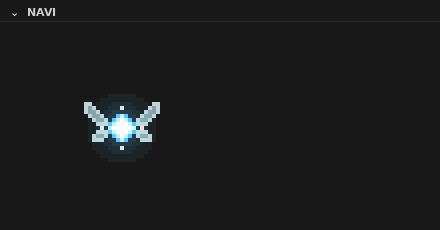

<p align="center">
  
</p>

<h1 align="center">Navi</h1>

<p align="center">
  Uma fadinha de pixel art que vive no <b>Explorer</b> do VS Code, logo abaixo dos seus arquivos, e reage ao seu código.
</p>

<p align="center">
  
</p>

## ✨ O que ela faz

| | |
|---|---|
| 🧚 **Voa por aí** | Passeia pelo painel com asas batendo, brilho pulsante e um rastro de faíscas |
| 🖱️ **Interage com o mouse** | Orbita o cursor; clique nela pra ouvir o que ela tem a dizer; clique em outro lugar e ela voa até lá |
| 💾 **Comemora quando você salva** | Dá uma voltinha e avisa que o arquivo foi salvo |
| ⚠️ **Avisa sobre erros no arquivo** | Fica laranja quando o arquivo aberto tem erros e comemora quando você corrige |
| 🔴 **Reage a erros de execução** | Fica vermelha e balança quando um comando no terminal, uma task ou o debug termina com erro |
| 💤 **Dorme** | Depois de 2 minutos sem atividade ela pousa e dorme. Digite ou clique para acordá-la |

## 📦 Instalação

### Pela loja do VS Code (recomendado)

1. Abra a aba **Extensões** no VS Code (`Ctrl+Shift+X`)
2. Busque por **Navi Fairy Pet**
3. Clique em **Instalar**

Ou instale direto pelo [Visual Studio Marketplace](https://marketplace.visualstudio.com/items?itemName=guscfer.navi-pet), ou pela linha de comando:

```bash
code --install-extension guscfer.navi-pet
```

### Manualmente

Baixe o `.vsix` em [Releases](https://github.com/GusCfer/navi-fairy-vscode/releases) ou gere a partir do código:

```bash
git clone https://github.com/GusCfer/navi-fairy-vscode.git
cd navi-fairy-vscode
npx @vscode/vsce package
code --install-extension navi-pet-*.vsix
```

Depois, abra o **Explorer** e expanda a seção **Navi**.

## ⌨️ Comandos

| Comando | O que faz |
|---|---|
| `Navi: Chamar a fada` | Abre o painel e a fada dá um oi |
| `Navi: Trocar cor` | Escolhe a cor do brilho |

## ⚙️ Configurações

| Configuração | Padrão | Descrição |
|---|---|---|
| `fadaPet.cor` | `azul` | Cor do brilho: `azul`, `verde`, `rosa`, `amarela`, `roxa` |
| `fadaPet.tamanho` | `3` | Escala do pixel art (2 a 5) |
| `fadaPet.frase` | `Ei! Escuta aqui!` | O que ela fala quando você clica e de tempo em tempo |
| `fadaPet.reagirErros` | `true` | Avisa quando o arquivo aberto tem erros |
| `fadaPet.dicas` | `true` | Fala sozinha de vez em quando |

## 🔍 Detecção de erros de execução

- **Terminal integrado:** comandos que terminam com código de saída diferente de 0 (requer o *shell integration* do VS Code, ativo por padrão em bash, zsh e fish). `Ctrl+C` é ignorado.
- **Tasks:** qualquer task que falhe.
- **Debug:** exceções e programas que terminam com código de erro.

> Usa o Code Runner? Ative `code-runner.runInTerminal` para que ela perceba os erros.

## 📄 Licença

[MIT](LICENSE)
